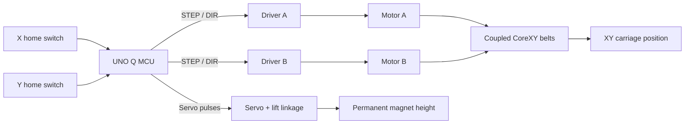

# CoreXY Gantry System - Components & Design

> Status: Preliminary electrical design, updated 2026-11-02
> Controller: Arduino UNO Q, 3.3 V MCU digital headers
> Motion: CoreXY, motors A and B
> Tool: Permanent magnet with servo lift (confirmed by user)

The previous independent X/Y motor architecture is superseded. Two fixed stepper motors drive the coupled CoreXY belts. Both participate in X and Y motion; each has its own driver. The carriage carries a permanent magnet and a servo-operated lift linkage. The electromagnet annotation in the brainstorm PDF is not part of the selected design.

## Architecture

Power and grounding are detailed in [CoreXYWiring.md](CoreXYWiring.md).

For one common sign convention, motor travel is A = X + Y and B = X - Y. Verify signs against actual belt routing and motor directions. Use the UNO Q MCU for coordinated step timing and home inputs; any Linux application should send motion requests to the MCU.

## Parts baseline

Shopping quantities come from the brainstorm PDF and do not prove purchase status.

| Item | PDF quantity | Proposed installation |
|---|---:|---|
| NEMA 17 stepper | 5 | 2; exact model/current unresolved |
| Stepper driver | Unspecified | 2; TMC2209 carriers proposed, DRV8825 alternative |
| GT2 6 mm belt | 10 m | Cut lengths per final routing |
| GT2 20T drive pulley | 5 | 2; matched to motor shafts |
| GT2 idlers | 10 toothed + 10 smooth | Per mechanical layout |
| Permanent N52 disc magnet | 6 | Carriage quantity to be confirmed |
| Metal-gear servo | 2 | 1 lift servo assumed; PDF link names MG996R |
| Mechanical limit switch | 6 | 2 home inputs; linked item appears to be endstop modules |
| Frame, wheels, spacers, springs, tape, fasteners | See PDF | Per mechanical assembly |
| UNO Q | Project notes | 1 |
| Motor DC supply | Unspecified | 24 V candidate; capacity unresolved |
| Servo regulator | Unspecified | Match exact servo voltage and stall/start demand |
| Controller power | Unspecified | Suitable USB-C source for initial build |
| Distribution, fuses, disconnect, cables, connectors | Unspecified | Add to electrical BOM |
| Driver capacitance/cooling | Unspecified | Match selected carriers and load |

NEMA 17 defines frame size, not electrical current. Supply ratings, driver settings, wire sizes and fuses remain provisional until exact loads are known.

## PCB decision

A custom PCB is optional. First use assembled driver carriers, power modules and secure terminal connections. After testing motion, switches and servo behavior, a small carrier PCB can consolidate the connectors, sockets, protection and signal routing. Avoid solderless breadboards for motor or servo power.

## References

- Local reference: Brainstorm Dump.pdf at C:/Users/reach/Downloads/Brainstorm Dump.pdf.
- [CoreXY operating principle](https://corexy.com/theory.html)
- [UNO Q pinout](https://docs.arduino.cc/resources/pinouts/ABX00162-full-pinout.pdf)
- [UNO Q power documentation](https://docs.arduino.cc/tutorials/uno-q/power-specification)
- [Detailed wiring draft and remaining decisions](CoreXYWiring.md)
