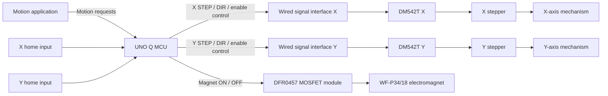
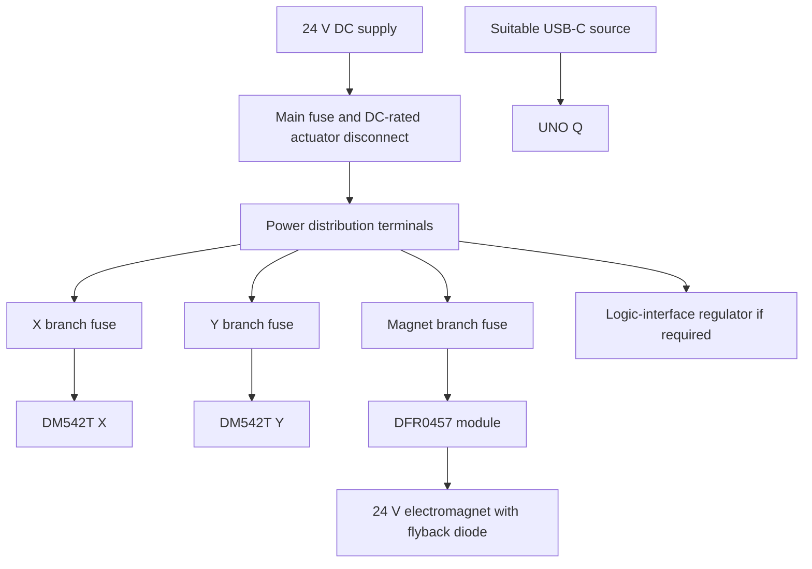

# Cartesian Gantry System - Components and Design

> Status: Preliminary design, updated 2026-11-16
> Controller: Arduino UNO Q using its 3.3 V MCU digital headers
> Motion: Cartesian X/Y, one independently driven motor per axis
> Drivers: Two external DM542T stepper drivers; exact purchased revision to be confirmed
> Tool: WF-P34/18 electromagnet assumed for the current design
> Electronics: Basic wired prototype using separate modules; custom PCB deferred until after validation

## System overview

The system positions an electromagnet using a two-axis Cartesian gantry. One stepper motor drives X and another drives Y. Each motor has its own DM542T driver. The UNO Q MCU generates coordinated motion signals and switches the electromagnet through a separate MOSFET module.

This Cartesian architecture supersedes the earlier CoreXY design. X and Y are independent mechanical axes: a pure X move commands the X motor, a pure Y move commands the Y motor, and a diagonal move coordinates both. Do not use the earlier CoreXY A = X + Y and B = X - Y motor mapping.

The working assumption is one motor per axis. The mechanical layout must establish how the gantry stays square and resists racking. A second motor for a dual-drive axis would require a revised driver count, homing scheme and power budget.

The electromagnet is the assumed tool, pending tests with the actual target and operating gap. A permanent magnet with servo lift remains a fallback rather than part of the base build. No servo or powered Z axis is included in the current baseline.

## Control architecture

Use the UNO Q MCU for pulse timing, coordinated acceleration, homing and fault handling. Any Linux-side application should send requests to the MCU. Exact header pins and timing-library support remain to be verified.

## Mechanical and motion baseline

- Two Cartesian axes using linear guidance and independent belt drives as the proposed mechanical baseline.
- GT2 6 mm belts and 20-tooth pulleys are existing candidate parts; routing, belt lengths, tensioning and suitability for the moving load remain to be finalized.
- Use the matched 17HS19-2004S1 motor pair provisionally: one motor for X and one for Y. Published ratings are 2 A per phase, 59 Ncm holding torque and a 1.8-degree step angle.
- Holding torque does not establish running torque, payload, speed or acceleration. Tune each axis for its actual moving mass; X and Y may need different acceleration limits.
- Secure the electromagnet to the tool carriage with a controlled working gap. Include moving-cable support and strain relief wherever motors, switches or the magnet move.
- Provide mechanical travel stops and verify that the frame stays square over the full travel.

For a direct-drive belt axis:

`steps/mm = (motor full steps/revolution x commanded microsteps/full step) / (belt pitch in mm x pulley teeth)`

With a 1.8-degree motor, a verified 2 mm-pitch belt and a 20-tooth pulley, travel is 40 mm per motor revolution. At a commanded 1/16 microstep setting, the nominal scale is 80 steps/mm. This is an example rather than a finalized driver setting; calibrate each axis independently against measured travel and include any transmission ratio.

## Motor drivers and controller interface

Use two external enclosed DM542T drivers. Mount them securely on a rigid base with the ventilation and mounting orientation required by their manufacturer. Connect each motor's four coil wires directly to its driver; route the motor wiring separately from home and control signals.

The DM542T V4.0 documentation specifies 5 V or 24 V control inputs. Provide a suitable wired 3.3 V-compatible transistor or buffer interface rather than assuming the UNO Q can drive those inputs directly. Select the interface for the exact input current, signal timing and driver revision. If using 5 V signaling, set the driver's signal-voltage selector accordingly.

Provide pulse, direction and enable-control connections for each axis. Verify enable polarity and power-up behavior on the purchased units: do not reuse TMC2209 enable assumptions. Define pulse states at startup, prevent unintended movement during reset, and require deliberate rearming after actuator power is interrupted.

Choose driver current settings using the motor rating and the exact driver's peak/RMS table. Do not interpret a 2 A motor nameplate as an instruction to set every driver parameter to 2 A. Verify coil pairs with power disconnected; do not rely only on wire colors. Remove driver power before connecting or disconnecting motors.

## Electromagnet and switching circuit

| Item | Current design basis |
|---|---|
| Electromagnet | Existing WF-P34/18 |
| Supply voltage | 24 V DC, confirmed from the user's unit |
| Nominal holding force | 180 N, confirmed from the user's unit |
| Coil current / wattage | Unknown; measure or obtain the exact rating |
| Duty cycle | Unknown; verify before prolonged energization |
| Switching module | DFRobot DFR0457, provisional pending coil-current verification |
| Flyback diode | Vishay 1N5408, provisional for simple on/off use pending coil-current verification |

The 180 N figure is a holding-force rating, not an electrical power rating or a guaranteed force through the working surface. Test attraction, movement and release with the actual piece, material thickness and clearances.

The DFR0457 supports a 5-36 V DC load supply and 3.3 V control signals. It switches the coil power separately from the UNO Q. Size the complete branch from the measured coil current, including module thermal limits, connectors, wire and fuse.

Add an external flyback diode across the coil, close to the electromagnet: cathode (striped end) to coil positive, anode to coil negative. The proposed 1N5408 is rated 3 A and 1000 V; verify current margin and operating conditions before finalizing it. Its voltage rating is blocking capability, not the voltage applied to the coil.

Use ordinary on/off switching initially. A flyback diode slows coil-current decay, so test release timing and residual attraction with the actual protection circuit installed. Rapid PWM or faster release would require a separately reviewed switching and suppression design.

## Power architecture

Use separate branches from the distribution point for both drivers and the magnet. Keep high-current returns out of UNO Q headers. Bond the grounds required by the selected control interfaces using the completed schematic; protective earth is separate from signal ground.

The total supply current is unresolved. Estimate simultaneous driver input power and coil power, then allow suitable operating margin. Motor phase-current ratings cannot simply be added to determine the 24 V supply current.

Keep UNO Q USB-C power separate for the initial design and prevent backfeeding through its headers. If a 5 V rail is used for driver signaling, select a suitable regulator and verify its current capacity and startup behavior.

The actuator disconnect must remove power from both motor drivers and the electromagnet independently of firmware. Removing electromagnet power can release the piece. This arrangement is not a certified safety system.

## Basic wiring first; PCB later

Build and validate the first system with separate modules and point-to-point wiring. A custom PCB is deferred until both axes, homing and the electromagnet work together reliably.

- Mount the UNO Q, two DM542Ts, signal-interface circuitry and DFR0457 securely on a rigid base.
- Use rated power distribution terminals and separate fused branches for the drivers and electromagnet.
- Connect motor coils directly to their drivers using suitable wire and connectors.
- Use secure terminal connections or soldered and insulated joints. Do not carry motor or electromagnet current through a solderless breadboard.
- Keep motor and magnet power wiring separate from pulse and home-input wiring, with strain relief on moving cables.
- Install the flyback diode close to the electromagnet and insulate its exposed connections.
- Label cables, connectors and polarity; document the tested pin assignments and wiring as the prototype is built.

After the prototype passes the verification below, use its proven circuit, measured currents and mounting requirements as the basis for the custom PCB. No PCB layout or fabrication is needed for this first stage.

## Homing and firmware behavior

Use one home input per axis initially. The existing RAMPS-style endstop modules have an unverified supply/output interface; do not connect an unknown 5 V output directly to a 3.3 V input. Accessible bare normally closed switch contacts with 3.3 V pull-ups are a candidate implementation.

Firmware should:

1. Start with magnet OFF and motion inhibited until initialization and deliberate arming are complete.
2. Home X and Y independently with controlled approach, backoff and repeat approach.
3. Apply independently calibrated steps/mm, travel limits, speed and acceleration for each axis.
4. Coordinate both axes for straight and diagonal moves.
5. Switch the magnet at defined points in the movement sequence, allowing measured engage/release delays.
6. Stop appropriately on home/limit faults and require rehoming after position may have been lost.

## Proposed installation BOM

| Component | Installed quantity | Selection / remaining work |
|---|---:|---|
| Arduino UNO Q | 1 | Existing controller choice |
| 17HS19-2004S1 stepper | 2 | Matched pair provisionally selected from inventory |
| DM542T driver | 2 | Selected family; confirm exact model/revision |
| Cartesian frame and linear guidance | 1 assembly | Final travel, stiffness, squaring and axis arrangement |
| GT2 6 mm belt | Per routing | Verify load suitability and final lengths |
| GT2 20T drive pulley | 2 | Verify shaft bore and fastening |
| Idlers and belt tensioners | Per routing | Determine from Cartesian layout |
| WF-P34/18 electromagnet | 1 | Existing 24 V, 180 N unit; verify consumption and duty |
| DFR0457 MOSFET module | 1 | Proposed; verify current capacity for actual coil |
| 1N5408 flyback diode | 1 | Proposed; verify coil-current margin |
| Home switches / verified interfaces | 2 | One per axis |
| 24 V DC supply | 1 | Capacity to be calculated |
| Logic-interface regulator | As required | Based on completed interface schematic |
| USB-C controller supply | 1 | Match UNO Q requirements |
| Power distribution terminals and wired signal interfaces | Per wiring plan | Required for the first prototype; custom PCB deferred |
| Disconnect, fuses, cables, connectors and mounting hardware | Per design | Select from actual loads and layout |

The brainstorm PDF's shopping quantities are historical references, not the installed BOM or proof of purchase. The servo, servo regulator and permanent magnet are omitted from this electromagnet baseline.

## Verification and remaining decisions

1. Confirm Cartesian axis layout, usable travel, moving masses and anti-racking arrangement.
2. Confirm the exact purchased DM542T revision and controller signal timing.
3. Measure electromagnet resistance/current and verify its duty rating.
4. Test the electromagnet at the actual working gap: engagement, movement, neighboring-piece disturbance and release. Test heating only within a verified operating rating.
5. Finalize the 24 V power budget, branch protection, wire sizes and connector ratings for the wired prototype.
6. Test one axis at a time, then coordinated moves and homing; verify operation through controller reset and actuator-power cycling.
7. Validate the complete wired system over repeated operating cycles and document the working circuit. Begin custom PCB design afterward.

## References and document status

This document is the current system-level baseline. **CoreXYWiring.md is a historical CoreXY/TMC2209 wiring draft and is not the wiring specification for this Cartesian/DM542T system.** Its pin assignments and driver-specific connections require revision before use.

- Local mechanical/parts reference: C:/Users/reach/Downloads/Brainstorm Dump.pdf.
- [17HS19-2004S1 manufacturer specifications](https://www.omc-stepperonline.com/nema-17-bipolar-59ncm-84oz-in-2a-42x48mm-4-wires-w-1m-cable-connector-17hs19-2004s1)
- [DM542T V4.0 manual](https://www.omc-stepperonline.com/download/DM542T_V4.0.pdf)
- [DFR0457 specifications and circuit documentation](https://wiki.dfrobot.com/dfr0457/)
- [Vishay 1N5400-1N5408 datasheet](https://www.vishay.com/docs/88516/1n5400.pdf)
- [UNO Q pinout](https://docs.arduino.cc/resources/pinouts/ABX00162-full-pinout.pdf)
- [UNO Q power documentation](https://docs.arduino.cc/tutorials/uno-q/power-specification)
- [Magnetic holding performance and working gaps](https://www.eclipsemagnetics.com/resources/guides/key-considerations/)

