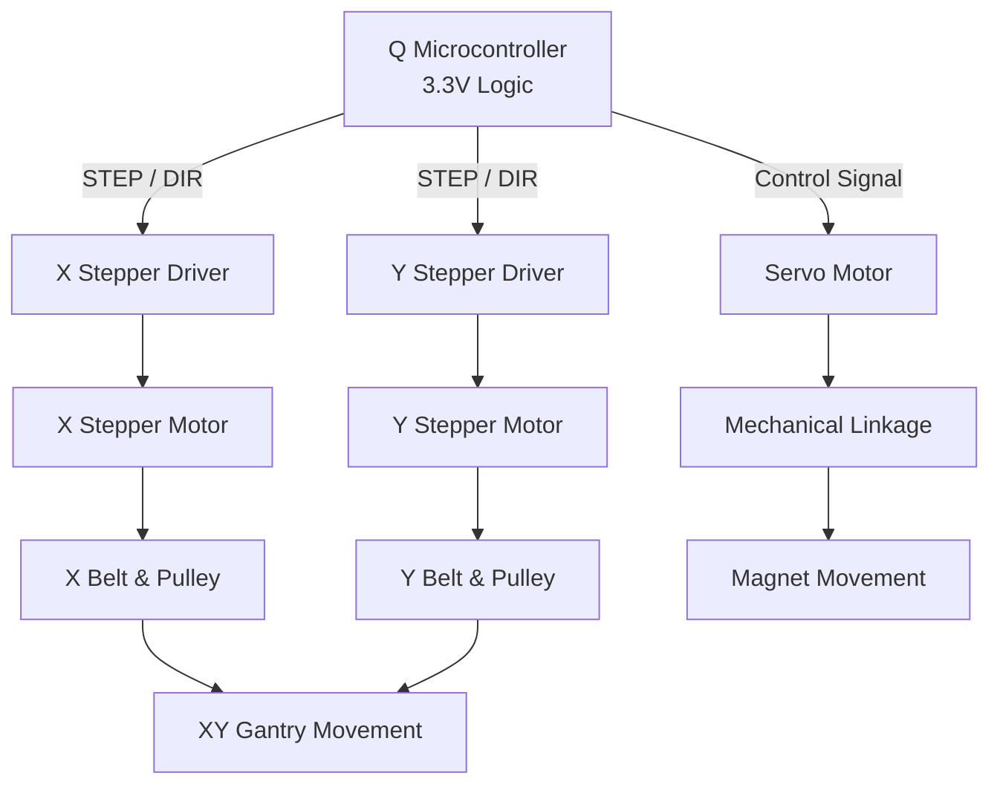

# XY Gantry System — Components & Design

> **Status:** Preliminary Hardware Design  
> **Controller:** Q Microcontroller  
> **Logic Voltage:** 3.3V  
> **Purpose:** XY positioning system with servo-actuated magnet

---

## 1. System Overview

The XY gantry system uses stepper motors to control movement along the **X and Y axes**.

A servo motor is mounted on the moving carriage and uses a mechanical linkage to control the position of a magnet.

The system is controlled by the **Q microcontroller**, which communicates with the stepper motor drivers and the servo.

> [!IMPORTANT]
> All control signals must be compatible with the Q's **3.3V logic level**.

### Main Subsystems

1. **XY Motion System** — Stepper motors move the gantry along the X and Y axes.
2. **Motor Control System** — Stepper motor drivers interface with the Q microcontroller.
3. **Servo Actuation System** — A servo motor and linkage control the magnet's position.

---

## 2. System Architecture

**Control flow:**

- The Q sends positioning commands through the stepper drivers.
- The stepper drivers regulate current through the stepper motors.
- The stepper motors rotate pulleys that drive the gantry belts.
- The servo independently actuates the magnet using a linkage.

*Note: Motor power supplies and grounding connections are omitted from this diagram.*

---

## 3. Proposed Hardware Components

### 3.1 XY Stepper Motors

**Purpose:** Control motion along the X and Y axes.

The motors rotate pulleys that move the gantry belts, allowing the carriage to move to specific XY coordinates.

#### Key Considerations

- Gantry mass and moving load
- Friction within the mechanical system
- Desired acceleration and speed
- Pulley dimensions
- Motor torque requirements
- Positioning precision

**Potential configuration:**
- 1 × X-axis stepper motor
- 1 × Y-axis stepper motor
- Timing belts and pulleys

> **Note:** Required motor torque depends on the gantry's mass, friction, acceleration, and pulley dimensions.

### 3.2 Stepper Motor Drivers

**Purpose:** Interface between the Q microcontroller and the stepper motors.

The drivers receive low-power control signals from the Q and regulate the electrical current supplied to the stepper motor coils.

#### Responsibilities

- Control motor stepping sequences
- Regulate motor coil current
- Support directional control
- Support microstepping for smoother movement
- Interface with 3.3V microcontroller signals

#### Candidate Drivers

| Driver | Description |
|---|---|
| TMC2209 | Quiet operation, microstepping, configurable current control |
| DRV8825 | Common stepper driver with current limiting and microstepping |

**Important:** Confirm the 3.3V logic compatibility of the specific driver modules.

### 3.3 Servo Motor + Mechanical Linkage

**Purpose:** Control the magnet attached to the XY gantry.

The servo motor is mounted directly onto the moving gantry carriage.

A mechanical linkage connects the servo motor to the magnet, allowing the magnet to move independently of the gantry's XY position.

#### Components

- Servo motor
- Servo mounting bracket
- Servo horn
- Mechanical linkage
- Magnet attachment

#### Operating Principle

1. The XY gantry moves to the desired coordinate.
2. The Q sends a control signal to the servo.
3. The servo rotates to the commanded position.
4. The linkage transfers the servo's rotation into mechanical movement.
5. The magnet changes position accordingly.

> **Design Note:** The required servo torque and linkage geometry depend on the magnet's mass, the desired movement, and the mechanical configuration.

---

## 4. Electrical Requirements

### 4.1 Logic Voltage

The Q microcontroller operates using **3.3V logic**.

All devices communicating directly with the Q must accept its logic levels or use appropriate level shifting.

### 4.2 Power Distribution

The microcontroller provides control signals, not the primary motor power.

- **Q Microcontroller:** Logic and control
- **Stepper Drivers:** Supply regulated motor coil current
- **Stepper Motors:** Receive power through the drivers
- **Servo Motor:** Requires a suitable power source

> [!WARNING]
> Do not assume that motors can be powered directly from the Q's 3.3V output.
>
> Select power supplies based on the motors' voltage and current requirements.
>
> Ensure the control system has appropriate common-ground connections.

---

## 5. Preliminary Bill of Materials (BOM)

| Component | Quantity | Candidate / Specification |
|---|---:|---|
| X-axis stepper motor | 1 | TBD |
| Y-axis stepper motor | 1 | TBD |
| Stepper motor drivers | 2 | TMC2209 / DRV8825 |
| Servo motor | 1 | TBD |
| Servo mounting bracket | 1 | TBD |
| Servo horn | 1 | Servo-compatible |
| Mechanical linkage | 1 assembly | TBD |
| Magnet | 1 | TBD |
| Timing belts | As needed | GT2 or equivalent |
| Timing pulleys | As needed | Motor-compatible |
| Gantry frame and rails | 1 assembly | TBD |
| Motor power supply | 1 | Based on motor requirements |
| Servo power supply | As needed | Based on servo requirements |
| Connecting wires | As needed | Appropriate gauge |

*TBD = To Be Determined*

---

## 6. Design Considerations

### Mechanical

- [ ] Determine gantry dimensions
- [ ] Calculate moving carriage mass
- [ ] Determine required stepper motor torque
- [ ] Select belt and pulley sizes
- [ ] Determine servo mounting location
- [ ] Design magnet linkage geometry
- [ ] Verify mechanical clearance throughout XY travel

### Electrical

- [ ] Confirm Q microcontroller pin availability
- [ ] Verify 3.3V driver logic compatibility
- [ ] Determine stepper motor voltage and current requirements
- [ ] Select appropriate motor power supplies
- [ ] Verify servo voltage and current requirements
- [ ] Establish common-ground connections
- [ ] Consider cable routing for the moving carriage

### Control / Software

- [ ] Configure STEP and DIR signals
- [ ] Implement X-axis movement
- [ ] Implement Y-axis movement
- [ ] Implement XY coordinate positioning
- [ ] Implement servo control
- [ ] Calibrate motor steps per millimeter
- [ ] Configure travel limits and homing
- [ ] Coordinate servo actuation with gantry movement

---

## 7. Open Design Questions

1. What are the required dimensions of the XY gantry?
2. How much mass will the moving carriage carry?
3. What speed and positioning accuracy are required?
4. Which stepper motors provide sufficient torque?
5. Which driver is best suited for the Q's 3.3V logic?
6. What type of servo motor is required?
7. How far must the magnet move?
8. What linkage geometry will provide the desired magnet movement?
9. What power supply configuration will the system require?

---

## 8. Summary

The system consists of three primary functional components:

| Subsystem | Function |
|---|---|
| Q Microcontroller | Coordinates overall system movement |
| Stepper Motors + Drivers | Control XY positioning |
| Servo Motor + Linkage | Actuate the magnet |

**Overall operation:**

`Q Microcontroller → Stepper Drivers → XY Gantry Positioning`

`Q Microcontroller → Servo Motor → Linkage → Magnet Actuation`

The XY movement and servo actuation are mechanically independent but coordinated through the Q microcontroller.
