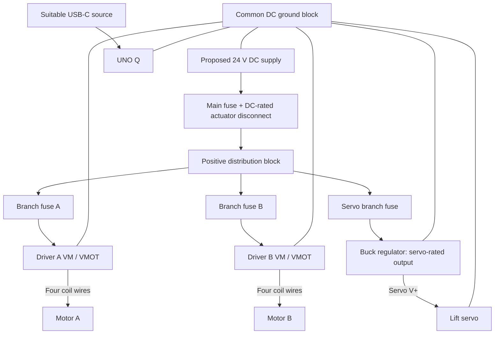
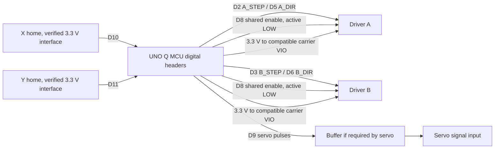

# CoreXY Wiring - Revision 0

Date: 2026-11-02. Preliminary connection plan; exact carrier pin positions, component ratings and current settings remain open.

## Design basis

- UNO Q using its 3.3 V MCU digital headers.
- Two CoreXY motors A/B, each with its own driver.
- TMC2209 carrier modules proposed in STEP/DIR mode, subject to motor current and carrier thermal capability. DRV8825 is an alternative requiring different support wiring.
- Permanent magnet and one servo lift. No electromagnet circuit.
- X and Y home inputs initially. Remaining switches can be spares or additional travel limits.
- 24 V motor rail proposed, subject to actual module limits and transient margin. Servo voltage separately regulated to its specification.
- UNO Q powered through a suitable USB-C source for initial tests.

## Power connections



Ground lines above mean negative/ground terminals only. Use a non-isolated buck, or explicitly bond its output negative to signal ground if an isolated unit is selected. Return motor/servo currents to the ground distribution block through rated conductors, rather than through UNO Q headers. Protective earth is separate from signal ground; follow the supply's enclosure/earth instructions.

The actuator disconnect removes power from the drivers and servo regulator. Select it for DC load interruption. Firmware must keep drivers disabled after power removal/reboot until deliberately rearmed and rehomed, since carriage position may have been lost.

Place bulk capacitance close to each driver's motor supply terminals. TMC2209 manufacturer guidance recommends at least 100 uF near the driver; account for the carrier's existing capacitance. Final capacitance and voltage rating depend on module limits, wire length and transients. A 50 V electrolytic is a candidate for a 24 V rail, not a guarantee of driver protection. Add servo-side capacitance per regulator/servo requirements.

## Signal connections



All signals share the ground described above. Servo power comes from its regulator. If its input accepts 3.3 V, connect D9 directly; otherwise use a non-inverting buffer with a 3.3 V-compatible input and a servo-compatible output level.

### Proposed MCU pin assignments

Logical header labels below are provisional; MCU timer/library compatibility still requires validation on UNO Q.

| UNO Q pin | Net | Connection |
|---|---|---|
| D2 | A_STEP | Driver A STEP |
| D5 | A_DIR | Driver A DIR |
| D3 | B_STEP | Driver B STEP |
| D6 | B_DIR | Driver B DIR |
| D8 | MOTORS_EN_N | Both active-low enable inputs |
| D9 | SERVO_SIGNAL | Servo input; buffer if needed |
| D10 | X_HOME | X home interface |
| D11 | Y_HOME | Y home interface |
| 3V3 | LOGIC_3V3 | Compatible TMC2209 VIO, switch pull-ups |
| GND | SIGNAL_GND | Common ground |

For the proposed TMC2209 design, add an external enable pull-up to 3.3 V so motors remain disabled while MCU pins are high impedance. Start with 10 kohm, checking onboard resistors on the selected carrier. Initialize STEP LOW and directions before enabling. Keep STEP inputs defined at startup, adding pulldowns if required by the carrier.

### Driver support connections to finalize

- Verify carrier manufacturer/revision, orientation, VM limits, VIO pin, sense resistors and continuous cooling capability. Similar carrier footprints do not establish interchangeability.
- Set identical commanded microstep resolution on both channels; specify MS/mode pin straps in the final schematic.
- Set coil current from the actual motor rating and carrier's current-setting method. Distinguish peak from RMS; no VREF value is assigned yet.
- UART is omitted from this draft. Confirm standalone current and mode operation on the actual TMC2209 carrier before enabling motors.
- DRV8825 substitution requires a revised diagram: nRESET/nSLEEP high for operation and MODE pin straps. The Pololu DRV8825 carrier has no external VIO/VDD supply pin. Do not connect 3.3 V to a presumed VIO position.
- Identify the motor's two coil pairs by continuity with power off. Connect one pair to each driver output bridge using the carrier's labels; do not rely on wire colors. Remove power before plugging/unplugging motors.

### Home input details

The PDF's limit-switch link names a three-wire RAMPS-style endstop module. Inspect its electronics and connector order; 3.3 V operation, output level and NC behavior are unverified.

For accessible bare switch contacts, use the following proposed circuit independently for each axis:

```text
UNO Q 3V3 --- 4.7 kohm ---+--- UNO Q home input
                          |
                          +--- switch NC contact
UNO Q GND -------------------- switch COM contact
```

The normally closed contact holds the input LOW when clear. Triggering the switch or opening its cable yields HIGH. Firmware treats HIGH as triggered/fault and debounces the input. This detects open circuits but not all failure types. If using module electronics instead, replace this circuit with the verified 3.3 V-compatible module interface. Add filtering as needed after checking noise and homing response.

## Electrical BOM still to resolve

| Item | Required information |
|---|---|
| Two stepper motors | Model, phase current, resistance, inductance, lead arrangement, step angle |
| Two driver carriers | Selected type, manufacturer/revision, schematic and cooling needs |
| One lift servo | Exact model, voltage, stall current, control threshold and pulse limits; PDF link names MG996R but does not verify the supplied unit |
| Two home inputs | Actual module/contact wiring and output circuit |
| Motor supply | Voltage/current from simultaneous operating loads and driver input power |
| Servo regulator | Output voltage and continuous/transient capacity including stall/start demand |
| Distribution | Fuses, DC disconnect, blocks, rated connectors, wire sizes and strain relief |
| Driver support | Bulk capacitors, cooling, mode straps, enable pull-up |
| Servo interface | Buffer if required, decoupling and rated carriage harness |

The PDF lists five motors, two servos and six switches as shopping quantities. This base design installs two motors, one servo and two home inputs. More actuators require more channels and a revised power budget.

## PCB recommendation

Use assembled modules mounted securely, with terminal blocks or rated connectors for power. Avoid solderless breadboards for motor/servo current. Test both motor channels, coordinated CoreXY moves, homing and loaded servo motion first. A custom carrier PCB can later consolidate driver sockets, connectors, protection, pull-ups, mode straps and capacitance. Existing driver/regulator modules remain suitable building blocks.

## Initial verification

1. Check polarity and regulator output before connecting loads.
2. Verify coil pairs, carrier orientation, current limits and cooling.
3. Confirm motors remain disabled through MCU startup; verify home input states before homing.
4. Test individual motors slowly, then small coordinated X/Y moves to verify signs and belt routing.
5. Test servo lift without forcing linkage stops; check for controller resets or false switch triggers.

## Sources

- Local parts/mechanical reference: C:/Users/reach/Downloads/Brainstorm Dump.pdf, pages 1-3. User confirmed permanent magnet and servo lift on 2026-11-02.
- [CoreXY principle](https://corexy.com/theory.html)
- [UNO Q pinout](https://docs.arduino.cc/resources/pinouts/ABX00162-full-pinout.pdf)
- [UNO Q power specifications](https://docs.arduino.cc/tutorials/uno-q/power-specification)
- [TMC2209 manufacturer datasheet](https://www.analog.com/media/en/technical-documentation/data-sheets/TMC2209_datasheet_rev1.09.pdf)
- [Pololu DRV8825 carrier documentation](https://www.pololu.com/product/2133/)
